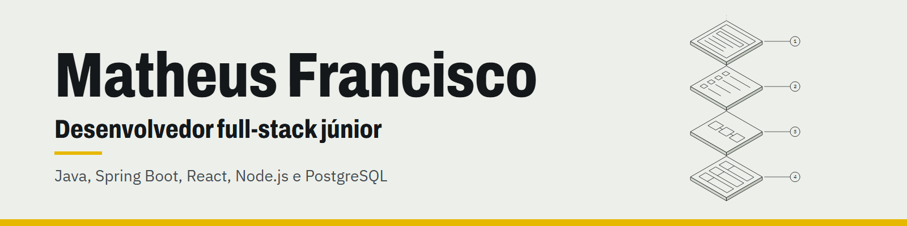

# Matheus Francisco Lucchetti da Silva

### Desenvolvedor Full-Stack Júnior
**Java / Spring Boot • React / Node.js • PostgreSQL**

[🌐 Portfólio](https://matheusfranciscols.github.io/) · [💼 LinkedIn](https://www.linkedin.com/in/matheusfranciscols) · [✉️ E-mail](mailto:matheusf.ls@hotmail.com)

🟢 **Aberto a vagas de desenvolvedor full-stack júnior.**

## Sobre Mim

Desenvolvedor full-stack em transição de carreira, com formação técnica em **Desenvolvimento de Sistemas pelo SENAI** e cursando **Ciência da Computação na Universidade Anhembi Morumbi**. Experiência prática na construção de aplicações robustas e completas, do banco de dados relacional à interface com o usuário.

Trago como diferencial **9 anos de vivência profissional na área comercial e de vendas**, o que me proporciona visão clara de processos de negócio, comunicação assertiva e foco em construir software que resolve as dores reais do cliente.

## Case Principal — CogniVault

**Catálogo técnico e orçamento de balcão para uma revenda autorizada Husqvarna.** Já está no ar. O atendente digita um código, uma peça ou um modelo e sai com preço, posição na vista explodida e orçamento pronto em PDF e WhatsApp. A regra central: nunca chutar o código. Código digitado devolve só o exato e a substituição oficial, e a IA só escolhe dentro de uma lista fechada. Mais de 1.300 testes automatizados e infraestrutura em planos gratuitos.

`React` `TypeScript` `Node.js` `PostgreSQL` `Prisma` `RabbitMQ` `Playwright` `Vitest`

[Abrir aplicação](https://cognivault-murex.vercel.app) · [Estudo de caso](https://matheusfranciscols.github.io/estudo-de-caso-cognivault/) · *projeto de trabalho, código privado*

## Projetos Selecionados com Deploy

| Projeto | O que resolve | Stack | Links |
| :--- | :--- | :--- | :--- |
| **BusinessFlow** | SaaS completo para gestão de pequenos negócios (CRM, financeiro, agenda e relatórios). | React, Node.js, PostgreSQL, Prisma | [Aplicação](https://flowbusiness.vercel.app) · [Código](https://github.com/MatheusFranciscoLS/BusinessFlow) |
| **Plataforma IoT Industrial** | Telemetria industrial em tempo real com microsserviços, mensageria e WebSockets. | Java, Spring Boot, React, RabbitMQ, WebSockets | [Aplicação](https://plataforma-iot-industrial.vercel.app) · [Código](https://github.com/MatheusFranciscoLS/plataforma-iot-industrial) |
| **Economia Solidária** | Marketplace do TCC SENAI conectando produtores locais e consumidores. | React, Node.js, Firebase | [Aplicação](https://economia-solidaria-frontend.vercel.app) · [Código](https://github.com/MatheusFranciscoLS/ProjetoFinal) |
| **FURIA Fan Chat** | Hub interativo com chat em tempo real, mural e placares para processo seletivo FURIA. | React, Vite, Firebase | [Aplicação](https://challenge1-furia.vercel.app) · [Código](https://github.com/MatheusFranciscoLS/Challenge1Furia) |

> Veja o [portfólio completo](https://matheusfranciscols.github.io/#projetos), com o estudo de caso do CogniVault e os demais projetos.

## Formações & Certificações Relevantes

- 🎓 **Bacharelado em Ciência da Computação** — Universidade Anhembi Morumbi *(Conclusão prevista: 10/2028)*
- 🛠️ **Técnico em Desenvolvimento de Sistemas** — SENAI *(Concluído: 2024)*
- 🏛️ **Ciência da Computação (CS50 de Harvard)** — Fundação Estudar • 70h (2025)
- ☕ **Programação Java** — SENAI • 120h (2022)
- 🗄️ **Programação de Banco de Dados (SQL Server / T-SQL)** — SENAI • 120h (2024)
- ☁️ **AWS Cloud Practitioner Foundational** — SENAI • 40h (2022)
- ☁️ **AI-900: Fundamentos de IA no Azure** — Fundação Bradesco • 16h (2025)

## Competências Técnicas

| Área | Tecnologias e práticas |
| :--- | :--- |
| **Back-end & arquitetura** | Java, Spring Boot, Spring Security, Node.js, Express, TypeScript, APIs REST, mensageria com RabbitMQ |
| **Front-end** | React, TypeScript, JavaScript, Vite, HTML5, CSS3, design responsivo e acessibilidade |
| **Dados & nuvem** | PostgreSQL, Microsoft SQL Server, Prisma, MySQL, Supabase, Firebase, Docker e deploy em nuvem |
| **Práticas de engenharia** | Git/GitHub, Postman, Scrum/Kanban, modelagem relacional, testes automatizados |

<strong>English version</strong>

### About

🟢 **Open to junior full-stack developer roles.**

Junior Full-Stack Developer in career transition, holding a technical degree in **Systems Development from SENAI** and pursuing a **B.Sc. in Computer Science at Universidade Anhembi Morumbi**. Hands-on experience building complete applications from relational databases to frontend interfaces.

My main differentiator is **9 years of professional sales and commercial experience**, giving me business vision, effective communication and a direct focus on solving real user needs.

### Core Stack & Highlights
- **Stack:** Java, Spring Boot, React, Node.js, TypeScript, PostgreSQL, RabbitMQ
- **Flagship Project:** [CogniVault](https://matheusfranciscols.github.io/estudo-de-caso-cognivault/en/) (parts catalog and counter quoting system for a machinery dealer; exact-code search, 1,300+ automated tests; private work project)
- **Certifications:** Harvard CS50 (70h), Java Programming SENAI (120h), Database Programming SENAI (120h)

---

  Projetado e desenvolvido por Matheus Francisco • Limeira, SP

